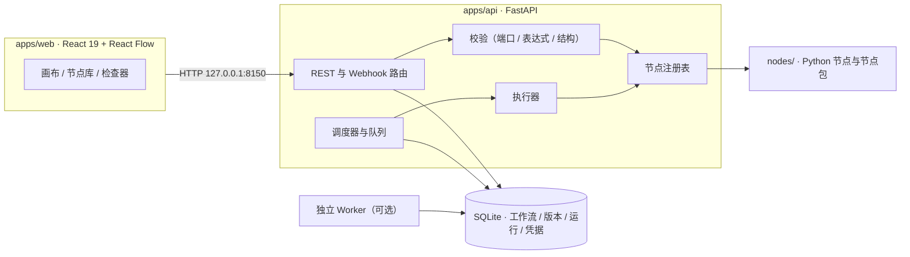

# Node Flow


Node Flow 是一个本地运行的通用工作流编排平台。前端是基于 React Flow 的可视化工作台，后端是 FastAPI 服务；`nodes/` 目录里的 Python 类通过 `@node(...)` 装饰器注册后，会自动变成可拖拽、可配置、可执行的工作流节点。

节点脚本同时是运行能力和界面元数据的来源：端口声明、JSON Schema 和声明式配置表单会驱动画布拖线、保存校验、运行前校验与运行详情，因此新增连接器不需要另外写前端页面。

## 特性

- **可视化编排** —— 画布连线、节点库搜索与分类、点击添加节点、可嵌套的循环体画布，节点位置与尺寸随工作流保存。
- **类型化节点契约** —— 输入输出端口声明 JSON Schema、连接过滤、多连接和动态端口；画布、保存校验与执行器使用同一套规则。`string` 不能连 `number`，`integer` 可以连 `number`。
- **运行与调试** —— 创建运行、实时轮询状态、执行事件时间线、节点级输入/输出/日志详情、批量结果表与逐条钻取。
- **保存失败可见** —— 保存失败（含版本冲突）会弹出提示并在顶部持续显示原因，版本冲突提供「重新加载服务器版本」与「另存为副本」两条恢复路径。
- **触发与集成** —— 手动触发、Webhook（方法/路径、自定义响应、访问保护凭据、HMAC 签名校验）、定时触发与工作流间同步调用。
- **执行策略** —— 节点级失败即停止 / 失败后继续 / 走错误端口，可配置尝试次数与重试间隔；支持错误处理工作流、固定调试输出与 600 秒默认全局超时。
- **版本与生命周期** —— 草稿与生产双版本、版本历史与恢复、生产回滚，节点配置按版本迁移（`migrate_config`）。
- **环境与凭据** —— 凭据在 Windows 上经 DPAPI 加密写入 SQLite（工作流只保存凭据 ID，日志与详情脱敏）、命名运行环境与变量快照、项目变量与 HTTP 配置档。
- **执行与队列** —— 全局并发上限与工作流级并发、SQLite 原子领取、嵌入式执行或独立 Worker 横向分担；取消是协作式的。
- **节点契约自检** —— `nodeflow-doctor` 校验 `nodes/` 下的节点与节点包清单、端口与动态端口契约。

## 工作台与服务端

工作台负责编排、配置、运行与查看结果；执行、调度、版本发布、节点包管理等由服务端与存储层承担。两者共用同一份 SQLite 数据库与节点契约。

| 层 | 主要能力 |
| --- | --- |
| 工作台界面 | 画布编排与节点配置、循环体、保存与导入导出（含保存失败与版本冲突提示）、运行与事件详情、批量结果、子工作流节点、Webhook 与定时触发配置、项目变量、凭据管理、HTTP 配置档、运行环境查看、节点工作室 |
| 服务端接口与执行器 | 执行策略与重试、错误处理工作流、版本历史与恢复、生产回滚、发布与停用、节点升级预览与应用、节点包安装与生命周期、Webhook 调试监听、触发器状态、运行取消/重试/队列位置/事件流、工作流校验、运行环境写入、独立 Worker 与运行恢复 |

界面用法见[工作台使用指南](docs/workbench-guide.md)，直接调用接口见[服务端行为参考](docs/platform-behavior.md)。

## 架构



工作流、版本、运行记录、环境、凭据与节点包策略都保存在同一个 SQLite 数据库；独立 Worker 通过原子领取与租约从同一队列取任务，因此 API 和 Worker 可以在不同进程中协作。

## 快速开始

需要 Python 3.11+（推荐 [uv](https://docs.astral.sh/uv/)）、Node.js 22+ 与 pnpm 10。

```powershell
# 后端依赖
uv sync --extra test

# 前端依赖
pnpm install

# 启动 API（127.0.0.1:8150）
uv run pnpm dev:api

# 另开一个终端，启动工作台（127.0.0.1:5273）
pnpm dev:web
```

打开 <http://127.0.0.1:5273> 即可使用。没有 uv 时，也可以激活虚拟环境后用 `python -m pip install -e ".[test]"` 安装依赖，再直接执行 `pnpm dev:api`。

| 服务 | 默认地址 |
| --- | --- |
| Node Flow API | `http://127.0.0.1:8150` |
| 工作台 | `http://127.0.0.1:5273`（备用 `5274`） |
| 演示 API | `http://127.0.0.1:8160`（`pnpm dev:demo-api`） |

后端 CORS 默认只放行 `5273` 和备用前端端口 `5274`，避免旧端口或其它本地项目误连。需要自定义前端地址时，在启动 API 前设置 `NODE_FLOW_EXTRA_CORS_ORIGINS`（逗号分隔），例如 `http://127.0.0.1:5275`。

## 编写第一个节点

在 `nodes/` 下新建一个 Python 文件即可：

```python
from pydantic import BaseModel
from nodeflow_sdk import BaseNode, NodeContext, Output, node


class DemoConfig(BaseModel):
    message: str = "hello"


@node(id="demo.echo", name="Echo", category="Demo", description="Return a message.")
class EchoNode(BaseNode[DemoConfig]):
    outputs = {"success": Output(display_name="回显", description="Echo result")}

    async def execute(self, ctx: NodeContext, inputs: dict):
        ctx.log.info("echo")
        return {"success": {"message": self.config.message}}
```

保存后在节点库点击“刷新节点库”，节点就会出现在画布左侧。提交前可用 `pnpm doctor:nodes` 运行与正式加载链路一致的契约自检。

完整说明见[节点开发指南](docs/node-authoring.md)，端口、动态端口与节点包生命周期的规范约定见[节点契约说明](docs/node-contracts.md)。

## 常用命令

| 命令 | 说明 |
| --- | --- |
| `pnpm dev:web` | 启动前端开发服务器（`127.0.0.1:5273`） |
| `pnpm dev:api` | 启动 FastAPI 服务（`127.0.0.1:8150`） |
| `pnpm dev:worker` | 启动独立 Worker（需先设置 `NODE_FLOW_EXECUTION_MODE=worker`） |
| `pnpm dev:demo-api` | 启动本地演示接口（`127.0.0.1:8160`） |
| `pnpm demo:setup` | 初始化演示凭据、HTTP 配置档和示例工作流 |
| `pnpm test` | 完整检查：lint + 前端测试 + 后端测试 |
| `pnpm test:web` / `pnpm test:api` | 单独运行前端 / 后端测试 |
| `pnpm lint` | 前端 TypeScript 检查 + 后端 ruff |
| `pnpm build:web` | TypeScript 检查与 Vite 生产构建 |
| `pnpm doctor:nodes` | 校验 `nodes/` 下的节点与节点包契约 |

## 项目结构

```text
node-flow/
├─ apps/
│  ├─ web/                    # React 19 + React Flow 工作台
│  └─ api/nodeflow_api/       # FastAPI 服务、执行器、节点注册表、存储
├─ nodeflow_sdk/              # 节点 SDK：BaseNode、@node、表单、脚手架
├─ nodes/                     # Python 节点与本地节点包
├─ tests/api/                 # 后端测试
├─ examples/                  # 演示 API 与演示数据
├─ docs/                      # 使用指南、契约文档与历史计划
└─ package.json               # 开发、测试与构建脚本入口
```

## 本地接口演示

仓库自带一个独立的演示接口和三份示例工作流，用于重复验收接口调用场景，覆盖单次请求、登录后串联和 CSV 批量调用（四行数据依次成功、失败、失败、成功）：

```powershell
pnpm dev:demo-api   # 127.0.0.1:8160
pnpm demo:setup     # 创建演示凭据、配置档与示例草稿
```

启动方式、验收步骤与接口清单见[本地接口调用演示](docs/demo-api.md)。

## 文档

| 文档 | 内容 |
| --- | --- |
| [工作台使用指南](docs/workbench-guide.md) | 画布与节点、保存与运行、运行结果、子工作流、触发器、表达式与变量、环境与凭据、测试节点 |
| [服务端行为参考](docs/platform-behavior.md) | 执行策略与重试、错误处理工作流、版本与发布、节点升级、触发器状态、运行控制与恢复、队列与 Worker、环境与变量接口 |
| [节点开发指南](docs/node-authoring.md) | 节点 SDK 用法、端口声明、配置表单、跨运行状态、节点包与升级迁移 |
| [节点契约说明](docs/node-contracts.md) | 端口与动态端口契约、包运行环境、生命周期与安装事务 |
| [本地接口调用演示](docs/demo-api.md) | 演示接口与三份示例工作流的验收流程 |
| [PRODUCT.md](PRODUCT.md) | 产品定位、用户、原则与约束 |
| [DESIGN.md](DESIGN.md) | 界面设计方向与组件约定 |
| [CONTEXT.md](CONTEXT.md) | 领域术语表 |
| [TODO.md](TODO.md) | 当前待办与已知问题 |
| [AGENTS.md](AGENTS.md) | 仓库工作约定（面向自动化 Agent） |

`docs/acceptance/` 保存阶段性验收与接手说明，`docs/research/` 与 `docs/superpowers/` 是研究记录和历史计划，仅作背景资料，不代表当前实现状态。

## 当前限制

- 节点脚本需要在 `nodes/` 中编写，工作台不提供在线 Python 编辑。
- 定位为本地单机工具，暂不提供多用户、认证与权限管理。
- 凭据库依赖 Windows DPAPI；其他平台会拒绝写入凭据，不会降级为明文存储。
- 不提供节点包在线市场、远程下载、包签名校验或代码沙箱，本地节点属于受信任的开发者代码。
- Webhook 流式响应和子工作流的异步后台调用尚未提供。

## 许可证

本项目基于 [MIT 许可证](LICENSE)发布。
